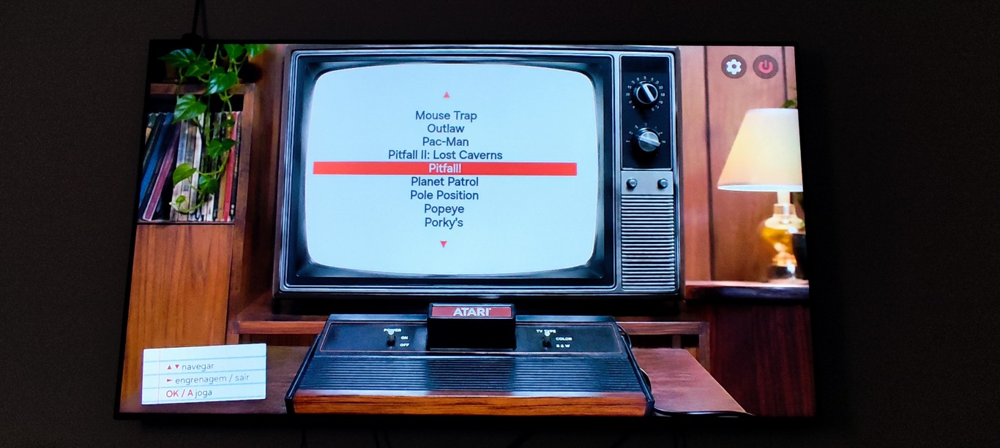
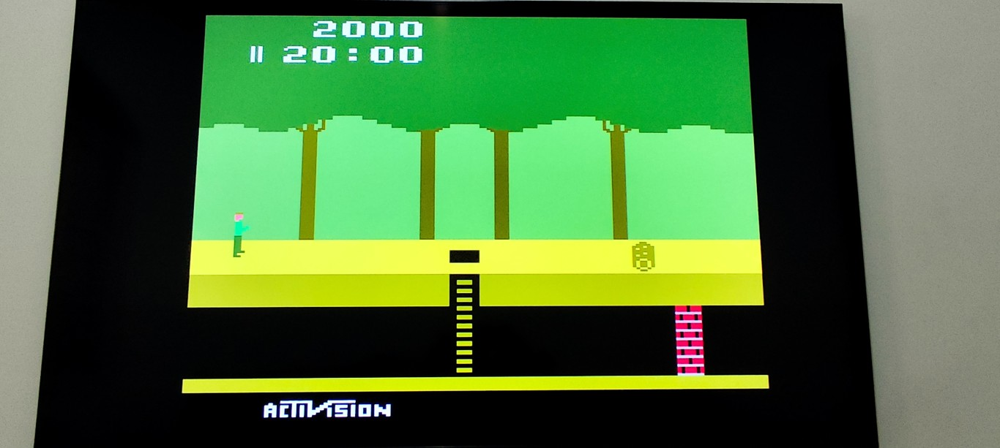
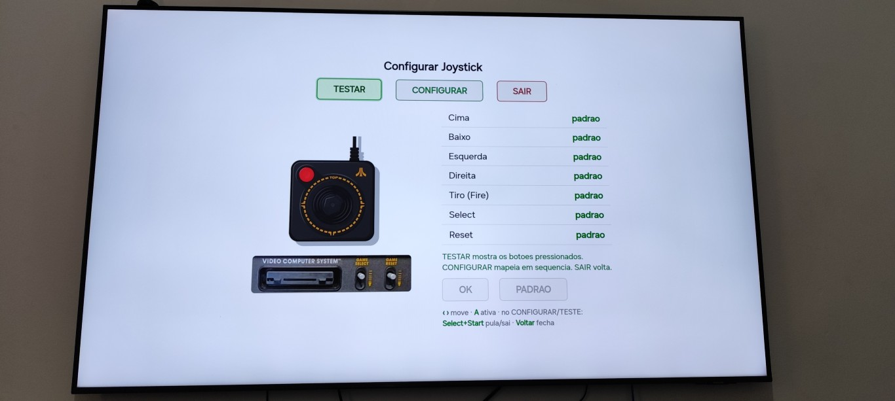
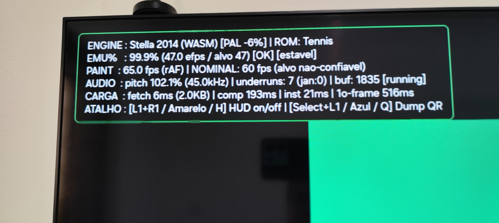
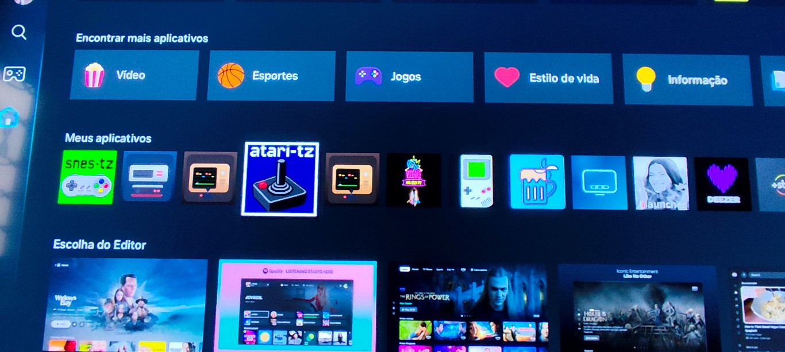

# 🕹️ Atari 2600 Emulator for Samsung Smart TV (Tizen)




Play **Atari 2600** games on your **Samsung Smart TV**. A self-contained web app (`.wgt`) you **sideload** onto the TV, running the **Stella 2014** core compiled to **WebAssembly** at full speed on the TV's modest SoC. Launches from the [lilauncher](https://github.com/mendes79/lilauncher) home screen or straight from the TV's app list.

> No root. No native binary. Just the TV's own WebView. Not affiliated with Atari or Samsung.

|  |  |
| :---: | :---: |
|  |  |
| _Full-speed gameplay (Stella 2014 in WASM)_ | _Interactive joystick configuration_ |
|  |  |
| _Built-in HUD measures real emulated FPS_ | _Launches from the lilauncher home screen_ |

## ▶️ Demo

<!-- TODO: cole aqui o link do vídeo de demonstração no YouTube. Ex.: [Watch the 60s demo](https://youtu.be/SEU_VIDEO) -->
_Demo video coming soon._

## Why this exists

Samsung's 2022 Tizen TVs ship a locked-down Chromium M85 web engine, no SIMD and no WebAssembly threads. Most emulator builds simply refuse to validate or crawl. This project ships a **lean, single-thread, scalar WebAssembly build** of Stella 2014 that actually runs full speed on that engine, wrapped in a TV-friendly UI you drive with a gamepad or the TV remote.

## What it is

- Target device: Samsung 65BU8000 (2022, Crystal UHD), Tizen 6.5, web engine Chromium M85.
- Core: Stella 2014 recompiled to a lean single-thread scalar WebAssembly module (no SIMD, no threads), so it validates and runs on the old Chromium M85.
- Delivered as a Tizen `.wgt` package. It is the same WebView used by the TV browser, so there is no native binary on the app side.

## Features

- Full-speed emulation on the target TV, validated with an honest speed meter (emulated frames per real second, not nominal FPS).
- Game selection screen rendered over a themed wallpaper, with vertical navigation and a settings panel.
- Settings: sound on/off and speed reduction presets (100%, -6%, -8%, -10%), persisted locally. The Atari runs several games slightly too fast at 100%, so the default is -6%.
- Interactive joystick configuration: a guided wizard maps each control, with a real controller photo that highlights the pressed control. Because the Atari uses the console switches for Game Select and Game Reset, the diagram also highlights those panel switches.
- Controls: directional, Fire, Select and Reset. Works with an 8BitDo Ultimate 2.4G (USB HID dongle) via the Gamepad API, and the simple set also fits the TV remote. Select+Start returns to the selection screen from a game.
- Catalog split: private commercial ROMs stay local and are never published; freely distributable ROMs ship in `roms_pub/`.

## Included free ROM

- Firefly by retroromrunner, released into the public domain. A complete Atari 2600 homebrew (title screen, a firefly you move with the joystick, a chasing enemy, score, rooms and sound) that also works as a screen, controller and sound test. See `roms_pub/CREDITS.md`.

## Repository layout

- `index.html` plus `js/` : the application (UI, input, audio, HUD, libretro frontend adapter).
- `js/stella.wasm` / `js/stella.js` : the compiled core.
- `core/` : core build record (reproducible build with Emscripten 3.1.56).
- `img/` : wallpaper, app icon, controller photo and highlight overlays.
- `roms_pub/` : freely distributable ROMs (published), plus `roms_pub.json`.
- `roms/`, `roms.json` : private commercial ROMs and catalog (git-ignored, not published).

## Installation

### 1. Enable Developer Mode on your TV

1. On the TV, open the Apps panel and open App Settings.
2. Type `12345` on the remote. The Developer Mode popup appears.
3. Turn Developer Mode = ON and enter your PC's LAN IP.
4. Reboot the TV.

### 2. Build, sign and install the app

Samsung signs every TV app with a certificate bound to that specific TV's DUID, so a prebuilt `.wgt` cannot be shared between TVs. Using Tizen Studio on Windows, create a Samsung certificate with your TV's DUID, then build, sign and install the app over the network and launch it. This is a one-time setup; later installs are quick.

### 3. Add your own ROMs so they appear on the selection screen

The selection screen is built from two catalog files that the app reads at startup. The free ROM already ships listed in `roms_pub.json`. To see your own games, you must add them and list them in `roms.json` (kept private, git-ignored):

1. Put your legally obtained `.a26` or `.bin` files in the `roms/` folder (create it next to `index.html` if it does not exist).
2. Create or edit `roms.json` in the project root, a JSON array with one entry per ROM, each with `file`, `name` and `slug`:

   ```json
   [
     { "file": "my_game.a26", "name": "My Game", "slug": "my_game" }
   ]
   ```

   - `file` must match the file name inside `roms/` exactly.
   - `name` is what shows on screen; `slug` is a lowercase identifier.
3. Reinstall the app (the ROMs are packaged into the `.wgt`). The games now appear on the selection screen, merged and sorted together with the free ROM.

Need a detailed step by step with screenshots? See the installation guide: [docs/INSTALL.md](docs/INSTALL.md) (Portuguese: [docs/INSTALACAO.md](docs/INSTALACAO.md)).

## FAQ

**Does it work on my Samsung TV model?** Built and tested on a 65BU8000 (Tizen 6.5, 2022). It should work on the BU and AU 8000 families and nearby Tizen 6.x models. Other models are untested; reports welcome in Issues.

**Can I just install a ready `.wgt`?** No. Samsung binds each app signature to the TV's DUID, so you build and sign against your own TV. It is a one-time setup.

**Is this legal?** The emulator code is MIT and ships no copyrighted ROMs (only the public-domain Firefly). You provide your own legally obtained ROMs.

## License

- Original application code: MIT (see LICENSE).
- Third-party components keep their own licenses (see THIRD-PARTY.md): the Stella 2014 core under GPL v2, and the Firefly ROM in the public domain. This project is free and non-commercial.

## Legal Disclaimer

This project is an independent, unofficial emulator developed for educational purposes only.

- This repository does not include any copyrighted ROMs or proprietary assets. The only bundled ROM is Firefly, released into the public domain.
- Users must provide their own legally obtained Atari 2600 ROMs to play other games. Private commercial ROMs stay local and are never published.
- This project is not affiliated with, endorsed by or associated with Atari or the Atari 2600 (Video Computer System).
- All trademarks and registered trademarks are the property of their respective owners.

## Credits

- [Stella 2014 core](https://github.com/libretro/stella2014-libretro): the [Stella](https://github.com/stella-emu/stella) authors and the [libretro](https://www.libretro.com/) team.
- [Firefly ROM](https://github.com/retroromrunner/firefly-atari-2600): retroromrunner (public domain).
- Controller photo, selection wallpaper, app icon and highlight overlays: see THIRD-PARTY.md.
- GameBoy reference harness and the [lilauncher](https://github.com/mendes79/lilauncher) project, which this emulator plugs into.

## Related projects

- [lilauncher](https://github.com/mendes79/lilauncher) — the custom Samsung TV home screen this emulator launches from.
- [SNES Tizen Emulator](https://github.com/mendes79/SNES-Tizen-Emulator) — same approach, Super Nintendo core.
- [Videokê TV](https://github.com/mendes79/videoke-tv) — karaoke station for the TV, real-time mobile queue via QR Code, launched from lilauncher.

Portuguese version: see [README.pt-BR.md](README.pt-BR.md).
