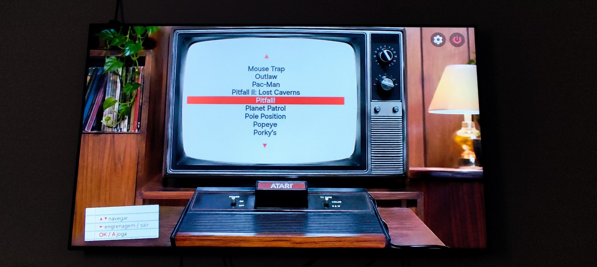
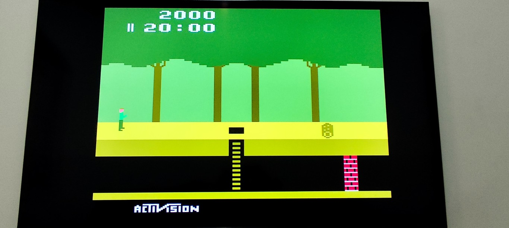
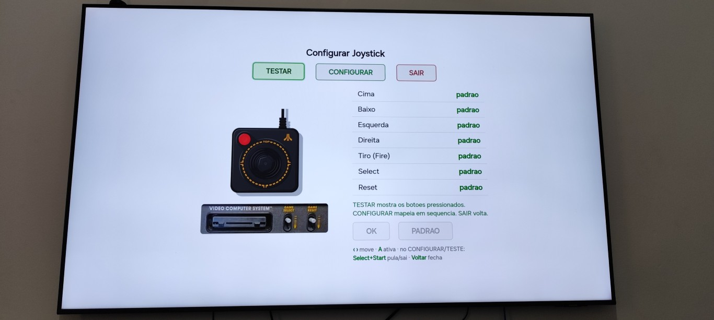
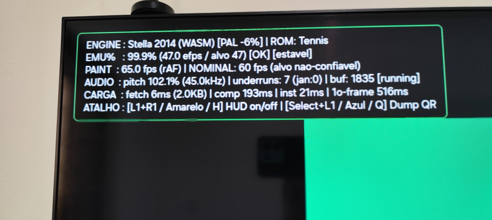
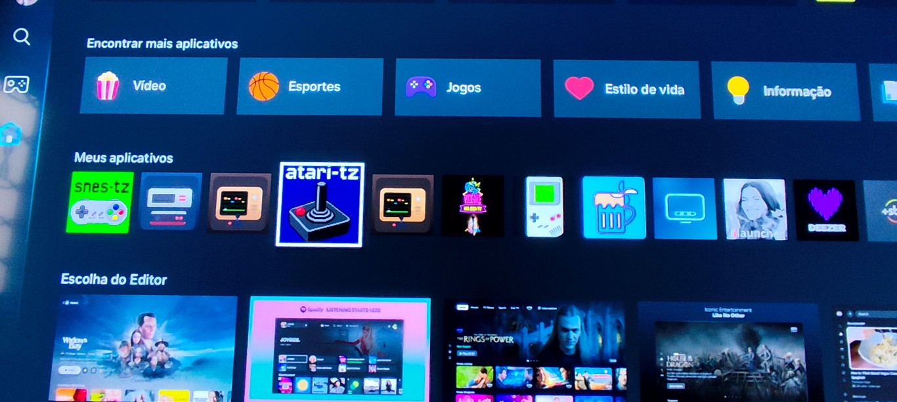

# 🕹️ Emulador de Atari 2600 para Smart TV Samsung (Tizen)




Jogue **Atari 2600** na sua **Smart TV Samsung**. Um aplicativo web independente (`.wgt`) instalado por **sideload** na TV, rodando o núcleo **Stella 2014** compilado para **WebAssembly** em velocidade cheia no SoC modesto da TV. Abre pela tela inicial do [lilauncher](https://github.com/mendes79/lilauncher) ou direto pela lista de aplicativos da TV.

> Sem root. Sem binário nativo. Apenas a própria WebView da TV. Sem vínculo com a Atari ou a Samsung.

|  |  |
| :---: | :---: |
|  |  |
| _Jogo em velocidade cheia (Stella 2014 em WASM)_ | _Configuração interativa do joystick_ |
|  |  |
| _HUD interno mede o FPS emulado real_ | _Abre pela tela inicial do lilauncher_ |

## ▶️ Demonstração

<!-- TODO: cole aqui o link do vídeo de demonstração no YouTube. Ex.: [Ver demo de 60s](https://youtu.be/SEU_VIDEO) -->
_Vídeo de demonstração em breve._

## Por que existe

As TVs Tizen da Samsung de 2022 trazem um motor web Chromium M85 travado, sem SIMD e sem threads no WebAssembly. A maioria das builds de emulador simplesmente não valida nem roda. Este projeto entrega uma **build enxuta de WebAssembly, single-thread e escalar** do Stella 2014 que roda em velocidade cheia nesse motor, dentro de uma interface pensada para a TV, controlada por gamepad ou pelo controle remoto.

## O que é

- Dispositivo alvo: Samsung 65BU8000 (2022, Crystal UHD), Tizen 6.5, motor web Chromium M85.
- Núcleo: Stella 2014 recompilado para um módulo WebAssembly enxuto, single-thread e escalar (sem SIMD, sem threads), para validar e rodar no antigo Chromium M85.
- Entregue como pacote Tizen `.wgt`. É a mesma WebView usada pelo navegador da TV, então não há binário nativo do lado do app.

## Recursos

- Emulação em velocidade cheia na TV alvo, validada com um medidor de velocidade honesto (quadros emulados por segundo real, não o FPS nominal).
- Tela de seleção de jogos sobre papel de parede temático, com navegação vertical e painel de configurações.
- Configurações: som ligado/desligado e presets de redução de velocidade (100%, -6%, -8%, -10%), salvos localmente. O Atari roda vários jogos um pouco rápido a 100%, então o padrão é -6%.
- Configuração interativa do joystick: um assistente guiado mapeia cada comando, com a foto real do controle que acende o comando pressionado. Como o Atari usa as chaves do console para Game Select e Game Reset, o diagrama também destaca essas chaves do painel.
- Controles: direcional, Fire, Select e Reset. Funciona com um 8BitDo Ultimate 2.4G (dongle USB HID) via Gamepad API, e o conjunto simples também cabe no controle remoto da TV. Select+Start volta à tela de seleção durante o jogo.
- Separação do catálogo: ROMs comerciais privadas ficam locais e nunca são publicadas; ROMs de livre distribuição ficam em `roms_pub/`.

## ROM livre inclusa

- Firefly, de retroromrunner, em domínio público. Uma homebrew completa de Atari 2600 (tela de título, um vaga-lume que você move com o joystick, um inimigo perseguidor, placar, salas e som) que também serve como teste de tela, controle e som. Veja `roms_pub/CREDITS.md`.

## Estrutura do repositório

- `index.html` mais `js/` : a aplicação (UI, entrada, áudio, HUD, adaptador de frontend libretro).
- `js/stella.wasm` / `js/stella.js` : o núcleo compilado.
- `core/` : registro de build do núcleo (build reproduzível com Emscripten 3.1.56).
- `img/` : papel de parede, ícone do app, foto do controle e overlays de destaque.
- `roms_pub/` : ROMs de livre distribuição (publicadas), mais `roms_pub.json`.
- `roms/`, `roms.json` : ROMs comerciais privadas e catálogo (git-ignored, não publicados).

## Instalação

### 1. Ative o Modo de Desenvolvedor na TV

1. Na TV, abra o painel de Apps e abra as Configurações de App.
2. Digite `12345` no controle. Aparece o popup de Modo de Desenvolvedor.
3. Deixe o Modo de Desenvolvedor = ON e informe o IP do seu PC na rede.
4. Reinicie a TV.

### 2. Monte, assine e instale o app

A Samsung assina cada app de TV com um certificado vinculado ao DUID daquela TV específica, então um `.wgt` pronto não pode ser compartilhado entre TVs. Com o Tizen Studio no Windows, crie um certificado Samsung com o DUID da sua TV, depois monte, assine e instale o app pela rede e abra. Essa configuração é feita uma vez só; as instalações seguintes são rápidas.

### 3. Adicione suas próprias ROMs para aparecerem na tela de seleção

A tela de seleção é montada a partir de dois arquivos de catálogo que o app lê ao iniciar. A ROM livre já vem listada em `roms_pub.json`. Para ver seus próprios jogos, adicione-os e liste em `roms.json` (mantido privado, git-ignored):

1. Coloque seus arquivos `.a26` ou `.bin` obtidos legalmente na pasta `roms/` (crie ao lado de `index.html` se não existir).
2. Crie ou edite `roms.json` na raiz do projeto, um array JSON com uma entrada por ROM, cada uma com `file`, `name` e `slug`:

   ```json
   [
     { "file": "meu_jogo.a26", "name": "Meu Jogo", "slug": "meu_jogo" }
   ]
   ```

   - `file` precisa bater exatamente com o nome do arquivo dentro de `roms/`.
   - `name` é o que aparece na tela; `slug` é um identificador em minúsculas.
3. Reinstale o app (as ROMs são empacotadas no `.wgt`). Os jogos passam a aparecer na tela de seleção, mesclados e ordenados junto com a ROM livre.

Precisa do passo a passo detalhado com telas? Veja o guia de instalação: [docs/INSTALACAO.md](docs/INSTALACAO.md) (inglês: [docs/INSTALL.md](docs/INSTALL.md)).

## Perguntas frequentes

**Funciona no meu modelo de TV Samsung?** Construído e testado em uma 65BU8000 (Tizen 6.5, 2022). Deve funcionar nas famílias BU e AU 8000 e em modelos Tizen 6.x próximos. Outros modelos não foram testados; relatos são bem-vindos em Issues.

**Dá pra instalar um `.wgt` pronto?** Não. A Samsung vincula a assinatura de cada app ao DUID da TV, então você monta e assina na sua própria TV. É uma configuração feita uma vez só.

**Isso é legal?** O código do emulador é MIT e não inclui nenhuma ROM com direitos autorais (apenas a Firefly, de domínio público). Você fornece suas próprias ROMs obtidas legalmente.

## Licença

- Código original da aplicação: MIT (veja LICENSE).
- Componentes de terceiros mantêm suas próprias licenças (veja THIRD-PARTY.md): o núcleo Stella 2014 sob GPL v2, e a ROM Firefly em domínio público. Este projeto é livre e não comercial.

## Aviso Legal

Este projeto é um emulador independente e não oficial, desenvolvido apenas para fins educacionais.

- Este repositório não inclui nenhuma ROM com direitos autorais nem ativos proprietários. A única ROM incluída é a Firefly, em domínio público.
- Os usuários devem fornecer suas próprias ROMs de Atari 2600 obtidas legalmente para jogar outros jogos. ROMs comerciais privadas ficam locais e nunca são publicadas.
- Este projeto não é afiliado, endossado nem associado à Atari ou ao Atari 2600 (Video Computer System).
- Todas as marcas e marcas registradas são propriedade de seus respectivos donos.

## Créditos

- [Núcleo Stella 2014](https://github.com/libretro/stella2014-libretro): os autores do [Stella](https://github.com/stella-emu/stella) e a equipe do [libretro](https://www.libretro.com/).
- [ROM Firefly](https://github.com/retroromrunner/firefly-atari-2600): retroromrunner (domínio público).
- Foto do controle, papel de parede da seleção, ícone do app e overlays de destaque: veja THIRD-PARTY.md.
- Harness de referência do GameBoy e o projeto [lilauncher](https://github.com/mendes79/lilauncher), no qual este emulador se encaixa.

## Projetos relacionados

- [lilauncher](https://github.com/mendes79/lilauncher) — a tela inicial personalizada da TV Samsung em que este emulador roda.
- [SNES Tizen Emulator](https://github.com/mendes79/SNES-Tizen-Emulator) — mesma abordagem, núcleo de Super Nintendo.
- [Videokê TV](https://github.com/mendes79/videoke-tv) — estação de karaokê para a TV, fila em tempo real pelo celular via QR Code, aberta pelo lilauncher.

Versão em inglês: veja [README.md](README.md).
